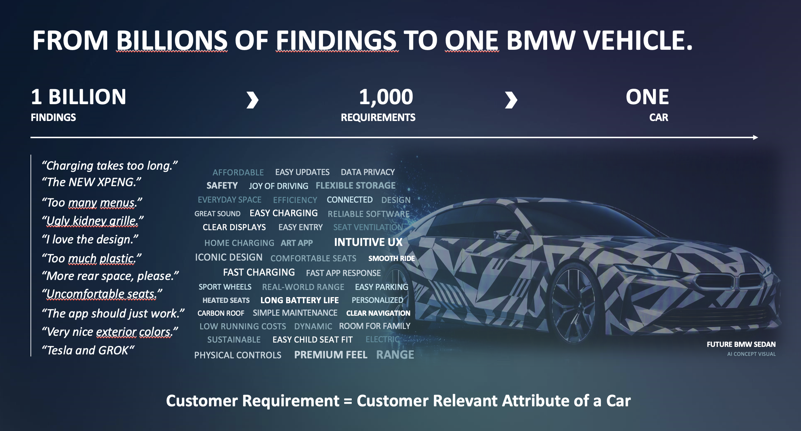

# From Billions of Findings to One BMW Vehicle

## Funnel

**1 billion findings → 1,000 requirements → one car**

> **Customer Requirement = Customer Relevant Attribute of a Car**

## Example findings (customer verbatims)

- "Charging takes too long."
- "The NEW XPENG."
- "Too many menus."
- "Ugly kidney grille."
- "I love the design."
- "Too much plastic."
- "More rear space, please."
- "Uncomfortable seats."
- "The app should just work."
- "Very nice exterior colors."
- "Tesla and GROK"

## Example requirements (word cloud)

Shown in different font weights/brightness in the image, which suggests relative importance. The boldest/brightest terms are grouped first.

**Most prominent:** Intuitive UX, Premium feel, Range, Fast charging, Long battery life, Safety, Easy charging, Flexible storage, Iconic design, Clear displays, Connected

**Medium:** Joy of driving, Easy updates, Data privacy, Design, Great sound, Easy entry, Comfortable seats, Smooth ride, Fast app response, Easy parking, Personalized, Heated seats, Clear navigation, Carbon roof, Simple maintenance, Room for family, Easy child seat fit, Physical controls, Sport wheels, Art app, Home charging, Dynamic

**Faint:** Affordable, Everyday space, Efficiency, Reliable software, Seat ventilation, Real-world range, Low running costs, Sustainable, Electric

## Visual

A camouflaged "Future BMW Sedan" (labelled "AI concept visual") sits behind the word cloud.

## Takeaway

The slide illustrates the core task: condense a huge volume of raw customer findings into roughly a thousand customer-relevant requirements, and from those define a single vehicle. The verbatims mix pain points ("too many menus"), praise ("I love the design") and competitor mentions (XPeng, Tesla, GROK), and each maps to a requirement such as Intuitive UX, Iconic design or Fast charging.
