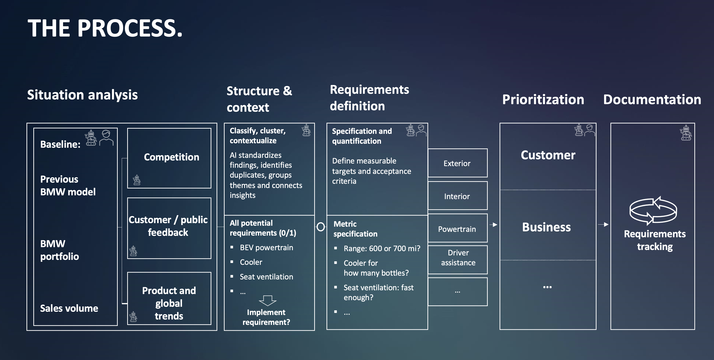

# The Process: From Findings to Tracked Requirements

End-to-end cycle for deriving and prioritizing customer requirements for a successor vehicle. Five stages, left to right:

**Situation analysis → Structure & context → Requirements definition → Prioritization → Documentation**

Icons in the diagram mark where a stage involves **AI (robot icon)** and/or a **human (person icon)**:

| Stage | AI | Human |
|---|---|---|
| Situation analysis – Baseline | yes | yes |
| Situation analysis – Competition | yes | – |
| Situation analysis – Customer / public feedback | yes | – |
| Situation analysis – Product and global trends | yes | – |
| Structure & context | yes | – |
| Requirements definition | yes | yes |
| Prioritization | yes | yes |
| Documentation | yes | – |

---

## 1. Situation analysis

Inputs that form the starting picture.

**Baseline** (AI + human):
- Previous BMW model
- BMW portfolio
- Sales volume

**External / contextual inputs** (feeding into the baseline, AI-supported):
- Competition
- Customer / public feedback
- Product and global trends

## 2. Structure & context

**Classify, cluster, contextualize** (AI): AI standardizes findings, identifies duplicates, groups themes and connects insights.

**All potential requirements (0/1)**: binary list of candidate requirements, e.g.
- BEV powertrain
- Cooler
- Seat ventilation
- …

Each leads to the decision question: **Implement requirement?** (yes/no, 0/1). Accepted candidates move on to definition.

## 3. Requirements definition

**Specification and quantification** (AI + human): define measurable targets and acceptance criteria.

**Metric specification**: open questions turned into measurable targets, e.g.
- Range: 600 or 700 mi?
- Cooler for how many bottles?
- Seat ventilation: fast enough?
- …

**Requirement categories** the requirements are sorted into:
- Exterior
- Interior
- Powertrain
- Driver assistance
- …

## 4. Prioritization (AI + human)

Requirements are prioritized along two perspectives:
- **Customer**
- **Business**
- … (further perspectives possible)

## 5. Documentation (AI)

**Requirements tracking**: shown as a continuous loop/cycle icon, i.e. requirements are tracked on an ongoing basis after prioritization.

---

## Flow summary

1. Gather the baseline (previous model, portfolio, sales) plus competition, customer/public feedback and trends.
2. AI classifies, clusters and contextualizes the findings into a list of candidate requirements; decide per candidate whether to implement it.
3. Specify and quantify accepted requirements with measurable targets and acceptance criteria, grouped by category.
4. Prioritize from customer and business perspectives.
5. Track requirements over time in documentation.

> Note: arrows in the diagram run from Requirements definition to Prioritization and from Prioritization to Documentation. The "Implement requirement?" gate sits between Structure & context and Requirements definition.
