<p align="center">
  <picture>
    <source media="(prefers-color-scheme: dark)" srcset="docs/assets/argon-banner-dark.svg">
    
  </picture>
</p>

<p align="center">
  <b>AI that turns customer voice, market data and competitor research into prioritized, evidence-backed requirements for the next BMW, with the product manager in control of every decision.</b>
</p>

<p align="center">
  TUM.ai Hackathon Final · BMW Group challenge <i>"AI for Product Decision Making"</i>
</p>

<p align="center">
  
  
  
  
  
</p>

---

## The problem

A BMW product manager defining the **successor** of a vehicle line (3 to 5 years ahead) has to read thousands of customer verbatims, customer studies, option lists, competitor news and trend reports, then argue for the roughly **top 10 requirements** that go to engineering. In interviews, BMW PMs told us research is the bottleneck, and that a tool is only useful if it is **no black box**: every proposal must show its source, market and evidence, and the PM decides.

## What Argon does

```
Signal  ──►  Case (problem)  ──►  PM confirms  ──►  Requirement (solution)  ──►  PM approves  ──►  engineering
```

| Step | What it is | Who acts |
|---|---|---|
| **Signal** | One statement about one feature from one source record (a BMW verbatim, a review sentence, a competitor fact, a trend), with the exact quote, market and source link. Invalid signals go to a visible quarantine. | AI extracts, a validation gate checks every quote against the stored record |
| **Case** | A customer problem built from a group of signals, e.g. *"Front seat ventilation too weak"*. Keeps all opinions per market and powertrain, so market conflicts become visible. Scored, but has no cost. | AI clusters, figures and tags; **PM confirms or rejects** |
| **Requirement** | What BMW will build, customer-facing and measurable: target vs. today's value and competitors, acceptance criteria, release (next generation, mid-life update, OTA), rough cost S/M/L. Every sentence carries its provenance: evidence, PM context or assumption. | AI drafts after confirmation; **PM approves**, head of product line signs off |

Everything is written to an **append-only audit trail** (actor, timestamp, before/after, rationale), from the source record to the human decision. A *trace replay* plays a requirement's whole life in about 15 seconds and re-checks the chain: every quote found in its source, every record hash intact, no gaps, a rationale on every status change.

### Highlights

- **Fixed taxonomy, no invented themes.** Every signal is classified into BMW's own labels: 219 topics, 11 aspect groups, 11 car areas ([`taxonomy/`](taxonomy/README.md)).
- **Explainable, tunable score.** Case score = weighted factors (distinct customers, severity, satisfaction gap, competitor gap, market volume, removed vs. predecessor, capped reach, trend) × brand-fit multiplier. The PM switches weight profiles and sees which items stay on top regardless. Requirement rank = case score × cost multiplier.
- **Reach is not relevance.** Distinct customers and capped reach keep one influencer from outranking a hundred owners.
- **Markets are separate worlds.** Conflicts (one market negative, another positive) are flagged with statistics and never decided by the AI.
- **Argus, the AI assistant.** A RAG sidebar on every case and requirement page that cites a signal ID for every claim ("no evidence found" otherwise) and proposes edits as diffs the PM accepts or rejects.
- **Daily web loop.** Competitor, customer, trend and innovation agents fetch from a curated source list within a daily budget; page content is treated as data, and agents can only write signals, never cases.
- **Collaboration built in.** Case ownership per line, series briefs, stances, open questions, referrals, an innovation pool, the vehicle plan and Codebeamer-style export.

## How signals become cases

AI agents propose, a validation gate checks, the case agent groups and the PM decides. Blue: AI · orange: PM · green: storage · red: gate. A case opens at ≥ 20 distinct customers of one BMW line (complaints and wishes at least as many as likes), ≥ 10 customers reporting a defect, a competitor gap or a removed feature. The full pipeline with every detail is in [`architecture.mmd`](architecture.mmd).

```mermaid
flowchart LR
    subgraph SRC ["Sources"]
        direction TB
        BMW["BMW data<br>10k verbatims · study · sales"]
        WEB["Web, daily<br>reviews · forums · news"]
    end

    subgraph AG ["AI agents"]
        direction TB
        A0["Seed classifier"]
        A1["Competitor agent"]
        A2["Feedback agent"]
        A3["Trends agent"]
        A4["Innovation scout"]
    end

    RAW[("Source records")]
    SIG["Signal<br>quote · topic · market"]
    TAX[["Fixed taxonomy<br>219 topics"]]
    GATE{"Validation gate<br>quote found?"}
    QUAR[("Quarantine")]
    SDB[("Signals")]

    subgraph CA ["Case agent"]
        direction TB
        G1["Group by<br>topic + aspect"]
        G3{"Enough<br>customers?"}
        WAIT["Wait for<br>more signals"]
        G4["Figures +<br>conflict flag"]
        G1 --> G3
        G3 -- "no" --> WAIT
        G3 -- "yes" --> G4
    end

    W1["Writer + tagger<br>cites signal IDs"]
    SCORE["Case score<br>8 weighted factors"]
    CASE["Open case<br>on PM board"]
    ARGUS["Argus<br>RAG assistant"]
    PM{"PM decides"}
    REQ["Requirement<br>agent drafts"]
    KEPT["Rejected,<br>kept with reason"]
    AUDIT[("Audit trail<br>append-only")]

    BMW & WEB --> RAW --> AG --> SIG
    TAX -. "closed lists" .-> SIG
    SIG --> GATE
    GATE -- "invalid" --> QUAR
    GATE -- "valid" --> SDB --> G1
    WAIT -. "next run" .-> G1
    G4 --> W1 --> SCORE --> CASE --> PM
    CASE <--> ARGUS
    PM -- "confirm" --> REQ
    PM -- "reject" --> KEPT
    PM -.-> AUDIT
    GATE -.-> AUDIT
    CA -.-> AUDIT

    classDef ai fill:#e8f0fe,stroke:#1c69d4,color:#000
    classDef human fill:#fff4e5,stroke:#e08a00,color:#000
    classDef store fill:#eef7ee,stroke:#2e7d32,color:#000
    classDef gate fill:#fdecea,stroke:#c62828,color:#000
    class A0,A1,A2,A3,A4,SIG,G1,G4,W1,SCORE,ARGUS,REQ ai
    class PM,CASE,KEPT,WAIT human
    class RAW,SDB,QUAR,AUDIT,TAX store
    class GATE,G3 gate
```



## Run it

**Demo UI (offline, synthetic data on top of real BMW verbatims):**

```bash
cd web && npm install && npm run dev
```

Open http://localhost:3000, pick a persona, and use **Reset demo data** in the persona menu. Demo scripts are in [`web/README.md`](web/README.md).

**Backend on a local embedded database (no Supabase, no OpenAI):**

```bash
cd backend && uv run python -m app.dev_local
```

Then start the UI against it with `DATA_SOURCE=backend` (API on `http://localhost:8000`, OpenAPI at `/docs`). Tests run offline with `uv run pytest`. For the full Supabase + OpenAI setup, copy `backend/.env.example` to `backend/.env` and see [`backend/API.md`](backend/API.md) and [`HANDOFF.md`](HANDOFF.md).

## Architecture

| Layer | Tech |
|---|---|
| UI | Next.js 16, React, Tailwind, shadcn/ui, TanStack Query; typed REST contract in Zod ([`web/src/contracts`](web/src/contracts), exported to [`contracts/`](contracts/openapi.yaml)) |
| API and agents | Python 3.12, FastAPI, background fetch worker |
| Storage | Supabase Postgres + pgvector (16 migrations), append-only audit table enforced in the database |
| AI | OpenAI chat models for classification, extraction, case pages, tags, Argus and requirement texts; `text-embedding-3-small` (768 dims) for clustering and hybrid search. Every output stores its model and prompt version |

Pipeline: configuration → one-time seed of BMW's data → daily fetch loop → signal validation gate → cases → case score → PM workspace → requirement generation → ranking and approval. The full diagram is [`architecture.mmd`](architecture.mmd).

## Data

BMW provided customer feedback for the 1, 5 and 7 Series (about 10,000 verbatims), a 2025 customer study, sales volumes to 2030 and German option lists. They are kept unmodified in [`docs/02-bmw-data/raw/`](docs/02-bmw-data/README.md) and loaded from the original files, so every value keeps its sheet and row. Competitors and 3-to-5-year trends come only from web research and are labelled as external or assumption. Known gaps (no Chinese feedback, US-heavy 5 and 7 Series data, no dates, no study sample sizes) are shown in the product, not hidden.

## Repository

| Path | Content |
|---|---|
| [`web/`](web/README.md) | The Argon UI and an offline mock backend that serves the same contract |
| [`backend/`](backend/API.md) | API, agents, scoring, seed, Supabase migrations, tests and reports |
| [`taxonomy/`](taxonomy/README.md) | The fixed classification (car areas, topics, aspect groups), build script and classifier eval |
| [`contracts/`](contracts/openapi.yaml) | REST contract between UI and backend (OpenAPI 3.1 + JSON Schemas) |
| [`docs/`](docs/README.md) | Challenge brief, BMW's data, PM interviews, team notes, web source list, solution concept, design and UX audit |
| [`landing/`](landing/index.html) | Intro loading page |
| [`architecture.mmd`](architecture.mmd), [`database-design.md`](database-design.md), [`data-model.mmd`](data-model.mmd) | Pipeline, database design and ER diagram |
| [`plan.md`](plan.md), [`changes.md`](changes.md), [`HANDOFF.md`](HANDOFF.md) | Implementation plan, every changed decision with its reason, current state |

## Team

Built in one weekend at the TUM.ai hackathon by
[Ghassen Zaara](https://github.com/ghassenzaara),
[kechich](https://github.com/kechich),
[Ahlem Trabelsi](https://github.com/ahlemtr),
[Yacine Dhouafli](https://github.com/yacine-dh) and
[Amine Cheikhrouhou](https://github.com/AmineChr54).
AI-assisted development sessions are recorded with [Entire](https://entire.io).

<sub>A hackathon prototype, not an official BMW product. BMW data was provided for the challenge.</sub>
