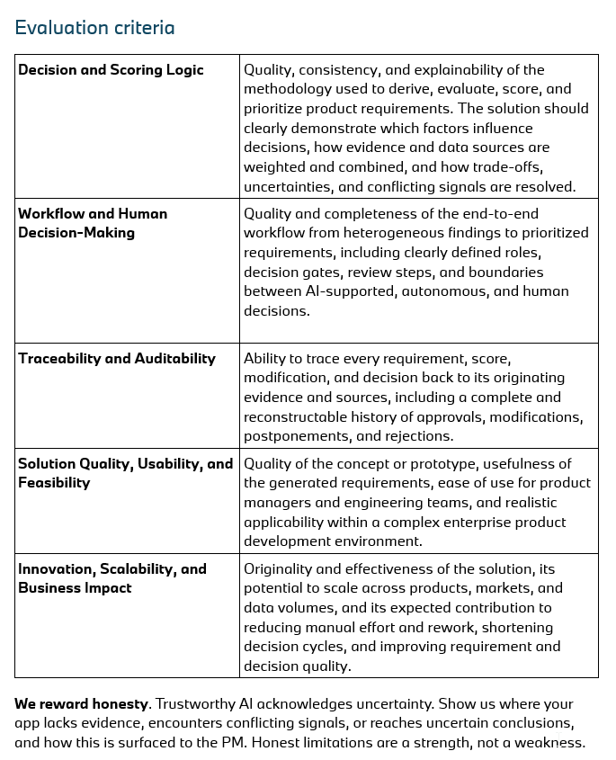

# Evaluation Criteria

How BMW judges the submissions. Transcribed from the slide. No weights were given, so treat the five criteria as equally important.

| # | Criterion | What the jury looks for |
|---|---|---|
| 1 | **Decision and Scoring Logic** | Quality, consistency and explainability of the method used to derive, evaluate, score and prioritize requirements. Show which factors influence decisions, how evidence and data sources are weighted and combined, and how trade-offs, uncertainties and conflicting signals are resolved. |
| 2 | **Workflow and Human Decision-Making** | Quality and completeness of the end-to-end workflow from heterogeneous findings to prioritized requirements. This includes clearly defined roles, decision gates, review steps, and the boundaries between AI-supported, autonomous and human decisions. |
| 3 | **Traceability and Auditability** | Every requirement, score, modification and decision can be traced back to its originating evidence and sources. That includes a complete, reconstructable history of approvals, modifications, postponements and rejections. |
| 4 | **Solution Quality, Usability and Feasibility** | Quality of the concept or prototype, usefulness of the generated requirements, ease of use for product managers and engineering teams, and realistic applicability in a complex enterprise product development environment. |
| 5 | **Innovation, Scalability and Business Impact** | Originality and effectiveness of the solution, its potential to scale across products, markets and data volumes, and its expected contribution to reducing manual effort and rework, shortening decision cycles, and improving requirement and decision quality. |

> **We reward honesty.** Trustworthy AI acknowledges uncertainty. Show us where your app lacks evidence, encounters conflicting signals, or reaches uncertain conclusions, and how this is surfaced to the PM. Honest limitations are a strength, not a weakness.

## What each criterion means for the build

| Criterion | Concrete things to show in the demo |
|---|---|
| Scoring logic | A visible formula or rubric (factors, weights, where each input comes from). PM-adjustable weights that re-rank the list live. Conflicting signals shown side by side, not averaged away. |
| Workflow | A diagram with the AI and human steps marked, and the mandatory review gates. Status values such as proposed, in review, approved, rejected, postponed. |
| Traceability | Click a requirement and reach its findings and the original verbatim, study row or URL. An audit log that records who or what changed what, when and why. |
| Usability and feasibility | Fits the PM's existing tools (Jira, Confluence, Codebeamer hand-off). A top-10 list ready to hand to engineering. Realistic for a 5 to 7 year model cycle. |
| Scalability and impact | The same pipeline runs for F70, G60 and G70 and for each market. Estimated time saved on research, which PMs call their biggest bottleneck. |
| Honesty | Evidence levels, sample sizes, data-coverage warnings (e.g. "90% of G60 verbatims are from the US, none from China"), and labels that separate assumptions from evidence. |

Related: [mission-and-deliverables.md](mission-and-deliverables.md) (deliverables), [stakeholder-needs.md](stakeholder-needs.md) (what the PMs told us).
