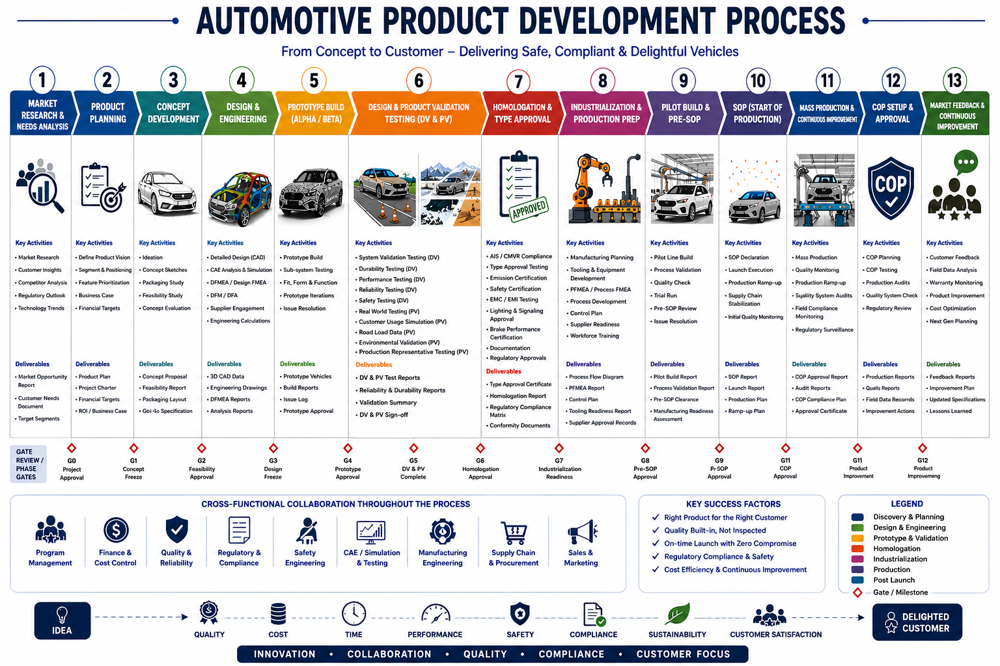

# Automotive Product Development Process (context)

A generic infographic of the automotive product development process. It is **not** an official BMW slide: the source is unknown and it looks AI-generated. Some gate labels are garbled, e.g. "Pr SOP" and two gates labelled G11. Use it to place the challenge in the wider lifecycle, not as a BMW fact.

## The 13 phases

| # | Phase | Key activities | Deliverables | Gate after phase |
|---|---|---|---|---|
| 1 | **Market research & needs analysis** | Market research, customer insights, competitor analysis, regulatory outlook, technology trends | Market opportunity report, customer needs document, target segments | G0 Project approval |
| 2 | **Product planning** | Define product vision, segment & positioning, feature prioritization, business case, financial targets | Product plan, project charter, financial targets, ROI / business case | G1 Concept freeze |
| 3 | Concept development | Ideation, concept sketches, packaging study, feasibility study, concept evaluation | Concept proposal, feasibility report, packaging layout, Go/No-go specification | G2 Feasibility approval |
| 4 | Design & engineering | Detailed CAD, CAE simulation, DFMEA, DFM/DFA, supplier engagement | 3D CAD data, engineering drawings, DFMEA reports | G3 Design freeze |
| 5 | Prototype build (alpha/beta) | Prototype build, sub-system testing, fit/form/function, iterations | Prototype vehicles, build reports, issue log | G4 Prototype approval |
| 6 | Design & product validation (DV & PV) | Durability, performance, reliability, safety, real-world testing, customer usage simulation | DV & PV test reports, validation summary, sign-off | G5 DV & PV complete |
| 7 | Homologation & type approval | Type approval testing, emissions, safety certification, EMC | Type approval certificate, homologation report | G6 Homologation approval |
| 8 | Industrialization & production prep | Manufacturing planning, tooling, PFMEA, supplier readiness, training | Process flow, control plan, tooling readiness | G7 Industrialization readiness |
| 9 | Pilot build & pre-SOP | Pilot line build, process validation, trial run | Pilot build report, pre-SOP clearance | G8 Pre-SOP approval |
| 10 | SOP (start of production) | SOP declaration, launch, ramp-up | SOP report, launch report | G9 SOP approval |
| 11 | Mass production & continuous improvement | Quality monitoring, ramp-up, field compliance | COP compliance plan, audit reports | G11 COP approval |
| 12 | COP setup & approval | Conformity-of-production planning, testing, audits | Production reports, approval certificate | G11 Product improvement |
| 13 | **Market feedback & continuous improvement** | Customer feedback, field data analysis, warranty monitoring, product improvement, **next-gen planning** | Feedback reports, improvement plan, lessons learned | G12 Product improvement |

Cross-functional teams: program management, finance & cost control, quality, regulatory, safety engineering, CAE/testing, manufacturing, supply chain, sales & marketing. Key success factors: right product for the right customer, built-in quality, on-time launch, compliance, cost efficiency.

## Where our tool sits

- **Phases 1 and 2 (bold)**, before gate G0/G1: market and customer research, then feature prioritization for the product plan. This is the "requirements for the successor" work.
- **Phase 13 feeds back into phase 1.** Feedback on the current car (our provided verbatims and study) becomes input for the next generation. This is the loop the team discussions describe.
- Everything from phase 3 onward (feasibility, engineering, homologation, production) is **out of scope** ([mission-and-deliverables.md](mission-and-deliverables.md)). Our output ends at the hand-off to engineering. Patrick named the hand-off tool: **Codebeamer**, with roughly the top 10 requirements ([PM interview](../03-meetings/2026-10-10_pm-interview-patrick_summary.md)).
- The "design freeze" mentioned in the team discussion corresponds to G3. Until then, requirements can still change, so the tool's monitoring loop is useful up to that point.

BMW-specific timing from the PM interviews: model life is about 5 to 7 years, with a life-cycle input (LCI, small changes) around year 3. A new generation takes about 5 years to reach the road, and car clinics can start up to 10 years before SOP.
