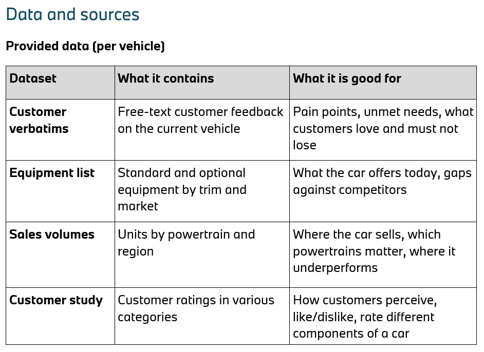

# Provided Data and Sources

The files themselves are described in [`../02-bmw-data/README.md`](../02-bmw-data/README.md).

## Provided data (per vehicle)

| Dataset | What it contains | What it is good for |
|---|---|---|
| **Customer verbatims** | Free-text customer feedback on the current vehicle | Pain points, unmet needs, what customers love and must not lose |
| **Equipment list** | Standard and optional equipment by trim and market | What the car offers today, gaps against competitors |
| **Sales volumes** | Units by powertrain and region | Where the car sells, which powertrains matter, where it underperforms |
| **Customer study** | Customer ratings in various categories | How customers perceive, like/dislike, rate different components of a car |
