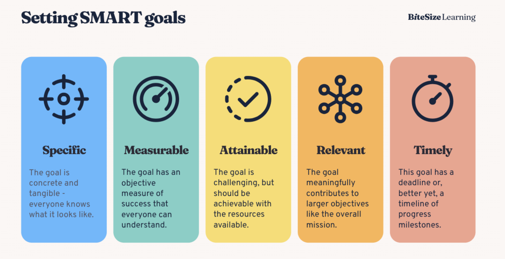

# Writing Good Requirements: SMART



The mission asks for requirements that are "clear, actionable, customer-facing and realistic". The SMART checklist is the test we apply before a requirement is proposed to the PM. The image is a generic BiteSize Learning slide. The fridge examples come from our own notes and from the PM interview, where Patrick used a fridge as an example of a China-specific wish.

| Letter | Meaning (from the slide) | Applied to a vehicle requirement |
|---|---|---|
| **S**pecific | Concrete and tangible, everyone knows what it looks like | Names the feature, the customer situation and the target derivative and market. "A fridge with a lot of space" fails. |
| **M**easurable | An objective measure of success everyone understands | Has a target value or acceptance criterion, e.g. bottles, km, seconds, a satisfaction score, share of complaints. |
| **A**ttainable | Challenging but achievable with the resources available | Plausible within one model generation and cost frame. "A fridge for 100 bottles" fails. Engineering decides feasibility, so we flag it as an assumption. |
| **R**elevant | Contributes to the larger objective | Traceable to evidence (customer, market, competitor) and fits BMW's brand (sporty, premium, efficient). Volume alone is not relevance. |
| **T**imely | Has a deadline or milestones | Tied to the successor's market entry (3 to 5 years out). States whether it still matters then, e.g. "competitors already offer X today". |

## Examples

| Bad | Why | Better |
|---|---|---|
| "Fridge with a lot of space" | Not specific or measurable | "Rear-console cooler for 2 × 0.5 l bottles, cools to ≤ 8 °C within 30 min, optional on G70 China" |
| "Fridge for 100 bottles" | Not attainable | (as above) |
| "Better infotainment" | Vague | "Reach the 5 most-used functions (radio presets, climate, phone messages) in ≤ 2 interactions, including physical shortcut buttons. Target: halve 'Difficult to Use' feedback on operation (G60/G70 US)" |
| "More range" | Not measurable, no reference | "Real-world highway range ≥ X km at 120 km/h, benchmarked against the top 3 competitors in the segment at successor launch" (X is an assumption, to be confirmed with engineering) |

## Requirement record (fields the mission requires)

Every requirement the tool produces should carry these fields (from [mission-and-deliverables.md](mission-and-deliverables.md), deliverable 2):

```yaml
id: REQ-G60-US-014            # unique identifier
title: Permanent auto start-stop off switch
description: >                # clear, actionable, customer-facing (SMART)
  Driver can disable auto start-stop (MSA) permanently via a stored setting
  that survives restarts. ICE and PHEV derivatives, all markets.
category: Powertrain / driving experience   # Exterior, Interior, Powertrain, Driver assistance, Infotainment ...
findings:                     # linked findings and sources
  - G60-0059, G60-0654, G60-0878 (customer verbatims, Wants, US)
  - G70 MSA wants: 13 verbatims
priority: 2                   # or a score (values here are illustrative)
score: 0.71
rationale: Frequent explicit want in both G60 and G70, low cost, quick win
evidence_level: High          # e.g. High / Medium / Low / Assumption
assumptions_uncertainties:
  - Regulation may limit permanent deactivation in some markets (out of scope, flag only)
status: proposed              # proposed / in review / approved / rejected / postponed
audit: [...]                  # who/what changed what, when, why
```

Related: [evaluation-criteria.md](evaluation-criteria.md), [process-cycle.md](process-cycle.md) (the metric-specification step).
