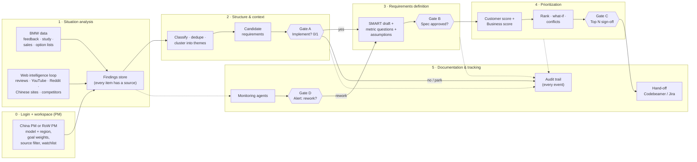

# End-to-End Flow: From Data to the PM's Decision

How our tool walks BMW's five-stage process ([process-cycle.md](../01-challenge/process-cycle.md)) from raw data to an approved, traceable requirement. For each stage: what goes in, what the AI does on its own, where the PM decides, what comes out, and which screen shows it. Scope and priorities are in [scope-and-focus.md](scope-and-focus.md). The external fetching loop and the per-PM workspaces are detailed in [web-intelligence-loop.md](web-intelligence-loop.md).


---

## 1. The flow at a glance



**Gates are diamonds.** Each gate is a **mandatory human decision**. Everything else the AI may do autonomously, because it only creates *proposals* and never changes the status of a requirement. Every step writes to the audit trail (dotted lines).

---

## 2. Stage by stage

### Stage 0 · Login and workspace (PM-initiated)
The PMs said they want to start the flow themselves ("a new model focused on speed") rather than receive an unprompted strategy `[PM1]`. BMW has a separate product management for China `[PM2]`, so the same car line typically has a **China PM** and a **rest-of-world (RoW) PM**. Each logs in to a **personal workspace**: a saved view on the **shared data layer**, not a copy ([web-intelligence-loop.md §4](web-intelligence-loop.md#4-one-data-layer-a-workspace-per-pm)).

| | |
|---|---|
| **PM inputs** | Login → workspace: vehicle line (e.g. G60 successor) · region scope (CN or RoW; US/ME possible) · use case (new model / improve / market variant) · goal weights (sportiness, comfort, tech, efficiency, budget) · source filter (e.g. current owners only, exclude social) · exploration level (only evidence-backed ↔ allow new ideas) · **watchlist** (competitors, topics, languages, sources for the web loop) |
| **AI does** | Validates that data exists for the scope and shows **coverage warnings** and a **coverage meter** per source and region (e.g. "no Chinese verbatims; China evidence = study + 140 web findings") |
| **Output** | `Workspace` object (user, model, region, weights, filters, watchlist), first audit event |
| **Screen** | *Login / workspace setup* |

### Stage 1 · Situation analysis: build the baseline
| | |
|---|---|
| **Inputs** | **Baseline:** previous model = current G60 (`equipment-baseline.md`, option lists), portfolio (F70, G70 for Baukasten comparisons), sales volumes (`sales_volumes.csv`) · **Customer/public feedback:** `feedback_verbatims.csv`, `study_*.csv`, plus web voices (YouTube comments and transcripts, Reddit, owner forums, Chinese platforms) · **Competition and trends:** professional reviews, competitor facts, launches, all from the **web intelligence loop** (Exa + YouTube API, run per workspace watchlist) |
| **AI does (autonomous)** | Load and normalize everything into **Findings**: one atomic, source-linked statement each (a verbatim, a study attribute score, a sales figure, a competitor fact, a trend claim). Tag market, powertrain, source type, trust level (A to F, see [external-sources.md](../02-data/external-sources.md)), date. For web sources: fetch → relevance filter → translate (keep original) → extract → dedupe, with a **deep link to the exact quote** and a stored **snapshot** of the page or transcript |
| **Human does** | Reviews the **situation dashboard**: where the car sells, what customers love (protect list) and hate, data gaps. May exclude sources |
| **Output** | Shared findings store (~10k verbatim findings + ~400 study findings + sales + external findings and `CompetitorFact`s), visible per workspace by region |
| **Screen** | *Situation dashboard* |

**The web intelligence loop inside Stage 1** (details in [web-intelligence-loop.md §5](web-intelligence-loop.md#5-how-fetching-works)):
```
Workspace watchlist (CN or RoW) ─┐                                  ┌─> Findings (shared store) ─> Themes
PM question (research agent) ────┼─> Exa · YouTube ─> Documents ────┤
                                 │   (search/fetch)   (snapshot)    └─> Monitor ─> Alert (Stage 5)
                                 └─ filter · translate · extract · dedupe · market + trust tagging
```

### Stage 2 · Structure & context: from findings to candidates
|                                            |                                                                                                                                                                                                                                                                                                                                                                                                                                                                                                                                                                                                                                                                                                                                                    |
| ------------------------------------------ | -------------------------------------------------------------------------------------------------------------------------------------------------------------------------------------------------------------------------------------------------------------------------------------------------------------------------------------------------------------------------------------------------------------------------------------------------------------------------------------------------------------------------------------------------------------------------------------------------------------------------------------------------------------------------------------------------------------------------------------------------- |
| **AI does (autonomous)**                   | 1. **Classify** the ~1,200 unlabelled verbatims (same taxonomy as BMW's VFC topics). 2. **Deduplicate and cluster** findings into **Themes** (e.g. "too many menus / missing physical buttons"). 3. **Contextualize:** link each theme to matching study attributes (e.g. *menu structure*), the equipment baseline (offered? standard or optional?), competitor facts, sales weight of the markets involved. 4. Compute theme stats per market: distinct verbatims, share by feedback type, severity, trend. 5. Propose a **candidate requirement** per theme (one line, binary: "Add X" / "Fix Y" / "Keep Z"). 6. Pre-check **brand fit** with a written reason, and flag off-brand candidates (the "rice cooker" case) instead of dropping them |
| **Gate A: "Implement requirement?" (0/1)** | **PM decides per candidate:** accept → definition · reject (reason required) · park / postpone · merge with another. Bulk actions allowed. The PM sees a **theme map** (clusters sized by evidence, coloured by sentiment), not 10,000 rows `[EN]`                                                                                                                                                                                                                                                                                                                                                                                                                                                                                                 |
| **Output**                                 | `Theme` objects, `Requirement` objects in status `candidate` → `accepted` / `rejected` / `parked`                                                                                                                                                                                                                                                                                                                                                                                                                                                                                                                                                                                                                                                  |
| **Screens**                                | *Theme map* + *Triage board*                                                                                                                                                                                                                                                                                                                                                                                                                                                                                                                                                                                                                                                                                                                       |

### Stage 3 · Requirements definition: specification and quantification
| | |
|---|---|
| **AI does (proposes)** | Draft a **SMART** requirement ([smart-requirements.md](../01-challenge/smart-requirements.md)): description, category (Exterior, Interior, Powertrain, Driver assistance, Infotainment …), **metric questions with proposed targets** ("Range: 600 or 700 km?"), using benchmarks where available. Each target is marked **evidence** (from data) or **assumption** (forward-looking), with sources. Lists uncertainties and conflicts |
| **Gate B: spec approval** | **PM edits and approves** the text and targets (e.g. chooses 700 km over 600). Every edit needs a short rationale and is logged with before/after |
| **Output** | `Requirement` in status `specified`, with `metrics[]`, `assumptions[]`, `evidence_level` |
| **Screen** | *Requirement detail* (the core screen) |

### Stage 4 · Prioritization: customer and business perspectives
| | |
|---|---|
| **AI does (autonomous calculation)** | Compute a **Customer score** and a **Business score** per requirement from visible factors (§4), combined with the PM's weights. Rank. Detect **conflicts** (market A vs market B, likes vs dislikes) and show them per market instead of averaging. Run **what-if**: "with budget focus, which items drop? Which stay on top in every weighting?" `[PM1]` |
| **Gate C: priority sign-off** | **PM** adjusts weights, overrides a rank (reason required), resolves conflicts (choose a market, make it a **regional variant** for the China or RoW workspace, or keep both; cross-workspace conflicts appear for both PMs), then **approves the top N (~10)** for hand-off `[PM2]` |
| **Output** | `Score` snapshots (with weights used), ranked list, status `prioritized` → `approved` |
| **Screens** | *Prioritization board* (ranked list + weight sliders) + *Customer × Business matrix* + *Conflict view* |

### Stage 5 · Documentation and tracking (continuous loop)
| | |
|---|---|
| **AI does (autonomous)** | Writes the **audit trail** for every action (§3). Exports approved requirements (Codebeamer- or Jira-style CSV/JSON with evidence links). The **web intelligence loop** re-runs each workspace watchlist on a schedule; the **monitor** compares new findings with approved requirements in the matching region and gives a verdict (*supports* / *contradicts* / *raises the bar*). For the last two it **flags** the requirement to its owning PM: "Xiaomi SU7 now offers 800 km CLTC; your target is 700 km". It never edits `[DE]` |
| **Gate D: alert resolution** | **The owning PM** reviews the flag with both sources side by side: dismiss (with reason) or send back to Stage 3 for rework. If the requirement is global, the other region's PM sees the alert read-only |
| **Output** | Audit log, export file, alerts, decision history ("declined in 2026 because …") |
| **Screens** | *Audit trail* (per requirement and global) + *Alerts inbox* + *Export* |

---

## 3. Data objects: the traceability chain

Everything is linked by IDs, so any requirement can be walked back to the original sentence a customer wrote.

```
User ──< Workspace (model, region, weights, filters, watchlist)      ← a view, not a copy
                         │
Document (web snapshot) ─┐
Source (BMW file) ───────┴──< Finding >──< Theme ──< Requirement ──< Score (per workspace weights)
CompetitorFact ──────────────────────────────────────────┘    │  scope: global | CN | RoW, variant_of
                                                              ├──< Alert (to owning workspace)
                                                              └──< AuditEvent (user | agent, workspace)
```

```jsonc
// Field values are illustrative
// Finding: one atomic piece of evidence
{ "id": "FND-G60-0878", "type": "verbatim",        // verbatim | study | sales | equipment | competitor | trend
  "source": { "file": "feedback_verbatims.csv", "ref": "G60-0878", "trust": "A" },
  "market": "US", "model": "G60", "engine": "ICE",
  "text": "…would prefer having an option to totally turn off the auto start stop…",
  "labels": { "feedback_type": "Wants", "topic": "Automatic engine start-stop function (MSA)" },
  "severity": 0.5, "date": "2025" }

// External Finding: same object, extra provenance (full schema in web-intelligence-loop.md §5)
{ "id": "FND-EXT-000412", "type": "social",       // review | social | competitor | trend
  "source": { "url": "https://www.reddit.com/r/BMWi5/…", "domain": "reddit.com", "trust": "D",
              "published_at": "2026-08-14", "retrieved_at": "2026-10-10T21:04:00Z",
              "document_id": "DOC-8812", "run_id": "RUN-g60_row-0007" },
  "locator": "https://www.reddit.com/r/BMWi5/…#:~:text=I%20miss%20the%20hard%20buttons",
  "quote_original": "I miss the hard buttons for the radio presets …", "quote_en": "…", "language": "en",
  "entity": { "kind": "bmw", "model": "G60" },
  "market": { "value": "US", "inferred_from": "subreddit + mentions", "confidence": 0.6 },
  "audience": "owner", "engagement": { "upvotes": 212 },  // stored, not used as weight
  "extraction": { "model": "<openai-model>", "prompt_version": "extract-v3" } }

// Workspace: one PM's personal view on the shared data
{ "id": "WS-G60-CN", "user": "pm.china", "model": "G60", "region": "CN",
  "weights": { "comfort": 0.4, "tech": 0.4, "sportiness": 0.2 }, "source_filter": { "social": true },
  "watchlist": "watchlists/g60_cn.yaml" }

// Theme: a cluster of findings
{ "id": "TH-G60-012", "title": "No permanent auto start-stop off", "finding_ids": ["FND-G60-0059", "…"],
  "stats": { "US": { "verbatims": 31, "wants": 10, "dtu": 21 } },
  "linked_study": [], "equipment_status": "not offered", "competitors": [] }

// Requirement: the object the PM decides on
{ "id": "REQ-G60-007", "theme_ids": ["TH-G60-012"], "status": "specified",
  "scope": "global", "owner_workspace": "WS-G60-ROW", "variant_of": null,   // or scope "CN" + variant_of a global REQ
  "title": "…", "description": "…", "category": "Powertrain / driving experience",
  "metrics": [{ "question": "Setting persists across restarts?", "target": "yes", "basis": "evidence" }],
  "assumptions": ["…"], "conflicts": [], "evidence_level": "High",
  "brand_fit": { "value": 0.8, "reason": "…", "confirmed_by": "PM" } }

// Score: snapshot, so old rankings are reproducible
{ "requirement_id": "REQ-G60-007", "weights_id": "W-03", "customer": 0.62, "business": 0.71,
  "total": 0.66, "factors": { "severity": 0.6, "reach": 0.4, "…": "…" }, "computed_at": "…" }

// Alert: raised by the monitor, resolved only by the owning PM (Gate D)
{ "id": "AL-0007", "requirement_id": "REQ-G60-CN-004", "workspace": "WS-G60-CN",
  "verdict": "raises_the_bar", "finding_ids": ["FND-EXT-001233"], "status": "open | dismissed | rework" }

// AuditEvent: append-only
{ "id": "EV-1042", "at": "2026-10-11T08:14:00Z", "workspace": "WS-G60-ROW",
  "actor": "PM:pm.row | agent:fetcher | agent:extractor | agent:clusterer | agent:monitor",
  "object": "REQ-G60-007", "action": "edit_metric | status_change | rescore | flag | export",
  "before": { "…": "…" }, "after": { "…": "…" }, "rationale": "…" }
```

**Status lifecycle:** `candidate → accepted | rejected | parked → specified → prioritized → approved → handed_off`, plus a `flagged` overlay from monitoring and `postponed` at any point. Only a human can move a status. The AI can only add proposals, scores and flags.

---

## 4. Prioritization logic (explainable by design)

Two perspectives, as on BMW's slide, each a weighted sum of visible factors. Each factor states its data source, so the PM can click "why?".

| Perspective | Factor | How it's measured | Data source |
|---|---|---|---|
| **Customer** | Severity | Defect 1.0 > Difficult to Use 0.7 > Want 0.5 > neutral. Source C "very serious" boosts it. "Doesn't work" weighs more than taste `[PM2]` | feedback |
| | Reach | Distinct verbatims and distinct web authors/documents in the theme ÷ total in scope (log-scaled). Owners weigh more than the general public; trust tier multiplies. Respects the source filter. **Not views, likes or subscribers** | feedback + web findings |
| | Satisfaction gap | Linked study attribute: low mean (EU/CN) or high bottom-3 / low top-2 (US) | study |
| | Regression | Customers lost something the predecessor had ("my old 740 had one") `[PM2]` | feedback, option lists |
| **Business** | Market weight | 2030 sales share of the markets the evidence comes from | sales |
| | Competitive parity | Share of benchmark competitors in the workspace's region offering it (must-have if most do) | `CompetitorFact`s from the web loop |
| | Brand fit | 0 to 1, AI-proposed with reason, **PM-confirmed** (sporty, premium, design, efficiency) | PM + LLM |
| | Goal alignment | Match between requirement category and the PM's goal weights | project setup |
| | Rough effort | S/M/L as a penalty, labelled **assumption** (cost is only a rough factor) | PM estimate |

`total = w_customer × Customer + w_business × Business`. The PM sets all weights; defaults are visible.

**Kept separate from the score:**
- **Evidence level** (High / Medium / Low / Assumption): how *sure* we are, not how *important*. High = at least 2 independent source types and enough verbatims in the target market. Shown as a badge next to the score, never mixed into it.
- **Protect list:** strong *Likes* (driving dynamics, exterior design, rear space on G70) become "must not lose" guardrails, not ranked items.
- **Conflicts:** when markets disagree, the tool shows scores *per market* and asks the PM to choose: one market, a market variant, or keep both.

---

## 5. What the PM sees (screen flow)

| # | Screen | Purpose | Key interactions |
|---|---|---|---|
| 1 | **Login / workspace** | Who am I, which car and region | China PM or RoW PM; model, region, goal sliders, source filter, exploration level, watchlist; switch workspace |
| 2 | **Situation dashboard** | "Where are we now?" `[PM1]` | Sales by market, study strengths and weaknesses, protect list, coverage warnings, **coverage meter** (findings per source and region), latest web findings, "Refresh now" (one live watchlist run) |
| 3 | **Theme map** | Context instead of 10k rows | Clusters by size and sentiment; filter by market or powertrain; exclude off-brand |
| 4 | **Triage board** | Gate A: implement 0/1 | Accept, reject, park, merge; evidence count and badge per card |
| 5 | **Requirement detail** | Gate B: specify | SMART text, metric targets (evidence vs assumption), evidence panel (verbatims, study, reviews, YouTube, Reddit, Chinese sources, competitor facts) → **deep link to the exact quote** + stored snapshot, scope (global / regional variant), conflicts, history |
| 6 | **Prioritization board** | Gate C: rank and sign off | Weight sliders → live re-rank with "moved because …"; Customer × Business matrix; what-if compare; **cross-workspace conflict cards** (China vs. RoW); select top N |
| 7 | **Audit trail** | Traceability | Timeline per requirement: who or what, when, before/after, why |
| 8 | **Alerts inbox** | Gate D: continuous loop | Monitor verdicts for my workspace ("raises the bar", "contradicts") with both sources → dismiss or rework |
| 10 | **Ask the research agent** | On-demand deep dive | "What do Chinese owners say about i5 rear space?" → cited findings added to my workspace |
| 9 | **Export** | Hand-off | Top N to Codebeamer- or Jira-style file, with evidence links |

---

## 6. Where AI acts and where humans decide

| Activity | AI autonomous | AI proposes, human confirms | Human only |
|---|---|---|---|
| Ingest, normalize, tag findings | ✅ | | |
| Fetch the web per watchlist, translate, extract, dedupe | ✅ | | (PM edits the watchlist) |
| Research agent on a PM question | ✅ (on request) | | |
| Classify unlabelled feedback, cluster, dedupe | ✅ | | (PM can correct) |
| Link themes to study, sales, equipment, competitors | ✅ | | |
| Brand-fit judgement | | ✅ | |
| Candidate → accepted / rejected (Gate A) | | | ✅ |
| Requirement text and metric targets (Gate B) | | ✅ | |
| Score computation | ✅ (formula is fixed and visible) | | |
| Weights, overrides, conflict resolution, top N (Gate C) | | | ✅ |
| Audit logging, export file generation | ✅ | | |
| Monitoring flags (web loop + new feedback) | ✅ (flag only) | | |
| Global vs. regional scope, regional variants | | ✅ (AI suggests from market evidence) | PM decides |
| Rework after a flag (Gate D) | | | ✅ |
| Feasibility and cost | | | Engineering, out of our scope |

---

## 7. Worked example: one requirement, end to end (G60, US)

Evidence values come from the real data; scores, ranks and PM choices are illustrative.

| Stage | What happens |
|---|---|
| **0 Setup** | PM: "G60 successor, US primary, EU contrast; goals: comfort 0.4, tech 0.3, sportiness 0.3; owners' feedback only." Warning shown: "EU verbatims: ~110 only" |
| **1 Situation** | Findings include G60-1430 ("wishes the vehicle still included the physical programmable memory buttons … 1-8 buttons made pulling up menus much quicker"), G60-1716 (radio presets as physical buttons), US study *menu structure* (top-2 36%, bottom-3 13%), *operation of heater/AC controls* (top-2 29%, bottom-3 15%), EU *easy-to-use infotainment* 8.26. The web loop adds owner posts and review quotes about menus and buttons (Reddit, forums, YouTube comments), each with a deep link. Equipment: Curved Display with OS 8.5 and BMW Controller; no physical favourite buttons in the option list |
| **2 Structure** | AI clusters these with other operating-concept verbatims into theme **"Too many steps for frequent functions / lost physical shortcuts"**. Related themes across the Baukasten: F70 touch screen 83 DTU, G70 operating concept 33 DTU ("harder than my prior 7 Series"). Candidate: *"Provide physical shortcuts for the most-used functions."* **Gate A:** PM accepts |
| **3 Definition** | AI draft: "Driver reaches the 5 most-used functions (presets, climate temperature/fan, phone messages) in ≤ 2 interactions, including programmable physical favourite buttons; applies to all G60 derivatives." Metric questions: how many buttons (6 or 8)? Which functions (from usage data: **missing, assumption**)? Regression flag ✅ (predecessor had 1 to 8 buttons). Competitor parity: the **web loop** checks reviews of the RoW benchmark set (E-Class, A6, Tesla) for physical vs. touch-only controls. Until that is fetched it stays marked as an assumption. **Gate B:** PM sets 8 buttons, notes "align with Baukasten for F70/G70" |
| **4 Prioritization** | Customer: severity medium (DTU), reach high across models, study gap clear, regression yes. Business: US + EU = ~65% of 2030 G60 volume, brand fit high (driver focus), effort S/M. Rank #2 of 14. **Stays top-3 under every weighting** in what-if. No market conflict. Evidence level **High** (feedback + study, 3 models). **Gate C:** approved in top 10 |
| **5 Documentation** | Audit: 11 events (created by clusterer, accepted by PM, target edited 6→8 with reason, rescored after weight change, approved, exported). Exported to Codebeamer CSV. Monitoring later flags: "new competitor launches touch-only cockpit with positive press". PM dismisses with reason |

---

## 8. Mapping to the deliverables

| Deliverable `[MISSION]` | Covered by |
|---|---|
| 1. Concept and prototype | Stages 0–5 + screens 1–9 |
| 2. Structured requirement list (ID, description, findings, score, rationale, evidence level, assumptions, status) | `Requirement` + `Score` objects; export of the top N |
| 3. End-to-end workflow with AI/human boundaries | §1 diagram, §2, §6 |
| 4. Audit trail | `AuditEvent` log, §3; Audit trail screen |
