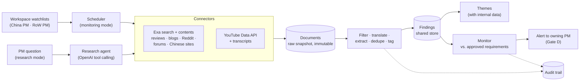

# Web Intelligence Loop and Multi-PM Workspaces

The design of our **core differentiator**: an agent loop that keeps fetching external voices (YouTube reviews, Reddit, Chinese platforms, professional reviews and blogs, competitor news), turns them into traceable findings, and alerts the right product manager when something changes. It runs on **one shared data layer** with a **personalized workspace per PM** (e.g. a China PM and a rest-of-world PM for the same car).

**Status:** design and build plan. No code exists yet. Related: [scope-and-focus.md](scope-and-focus.md) (priorities), [end-to-end-flow.md](end-to-end-flow.md) (the full process), [external-sources.md](../../docs/02-bmw-data/external-sources.md) (source list and trust levels).

---

## 1. Why this is our focus
- **The mission allows it explicitly:** "go deep on web research and turn external information into usable evidence" (`mission-and-deliverables.md` §3).
- **It fills the biggest data gap:** the provided feedback has **no Chinese verbatims**, only ~110 European verbatims for the 5 Series and ~19 for the 7 Series, and nothing about the future (`insights.md` §0).
- **It removes the PMs' biggest pain:** research, i.e. "combining lots of information from customers, social media, competitors, and redoing it every time you're challenged" `[PM1]`. Patrick: nobody systematically watches the "millions of hours" of video `[PM2]`.
- **BMW's own process slide** marks *Competition*, *Customer/public feedback* and *Product & global trends* as AI-only boxes, and *Documentation* as a continuous tracking loop.

## 2. Decisions taken
| Topic | Decision |
|---|---|
| Priority | Core differentiator (W7 + W8 = **Must**) |
| LLM | **OpenAI** API (the key is provided when development starts) |
| Search and fetch | **Exa** (~$20 credit available) |
| Extra keys | Only free ones: **YouTube Data API v3**. No Reddit API; Reddit goes through Exa |
| Demo | **Snapshot + one live refresh**: pre-fetched, cited results; one live run on stage |
| China | Search-based, small but real sample + an honest coverage meter. No paid anti-bot scraping |
| Priorities | Good traceability and good fetch quality over breadth |

---

## 3. Where it sits in BMW's process
| Stage ([process-cycle.md](../../docs/01-challenge/process-cycle.md)) | What the web loop contributes |
|---|---|
| **1 Situation analysis:** Competition, Customer/public feedback, Product & global trends | Produces **external Findings** in the same format as the Excel verbatims, tagged with source, market, language, audience and trust level |
| **2 Structure & context** | External and internal findings are clustered into the **same Themes**. A theme like "too many menus" then shows G60 verbatims *and* Reddit and YouTube voices side by side |
| **3 Requirements definition** | **Competitor facts** (range, charging, screens, features) become benchmarks for metric targets |
| **4 Prioritization** | Feeds the *competitive parity* factor; adds evidence for China, which otherwise has study data only |
| **5 Documentation and tracking** | **Monitoring:** new findings are compared with approved requirements. If one looks outdated, an **Alert** goes to the PM who owns it (Gate D). The loop **never edits** a requirement `[DE]` |



---

## 4. One data layer, a workspace per PM

### Why
Patrick: "China is so huge and important for us, it's nothing that we can solve from Munich". The US and the Middle East also have their own product management `[PM2]`. In practice, one car line has **a China PM and a PM for the rest of the world**. Their requirements are mostly similar, but China has some of its own (the in-car fridge example). Both must work from the **same evidence and the same logic**, which is Patrick's "single platform, same level of argumentation" target `[PM2]`.

### Model
```
User (PM login) ──< Workspace ── model (G60), region_scope (CN | RoW | US | ME …),
                     │            goal weights, source filters, exploration level, watchlist
                     │ is a *view* on the shared store, not a copy
Shared store:
  Document ──< Finding (market, language, entity, trust, audience) >──< Theme
  Requirement (scope: global | CN | RoW …, owner_workspace, variant_of → Requirement)
  Score (per requirement × workspace weights)
  Alert (target_workspace) · AuditEvent (actor = user | agent, workspace)
```

| Concept | Rule |
|---|---|
| **Workspace** | Saved filter + goals + watchlist for one PM, model and region. Switching workspace changes the view, not the data |
| **Global requirement** | Visible in all workspaces of that model; any PM can comment or challenge it; status changes need the owner (or both PMs, *decision*) |
| **Regional requirement** | `scope = CN` or `RoW`; visible to others read-only, marked "regional" |
| **Variant** | A regional requirement can be a variant of a global one (`variant_of`), e.g. "rear-console cooler, CN only" under "rear comfort". This matches the "build two variants" option `[PM1]` |
| **Cross-workspace conflict** | If CN accepts what RoW rejected (or the regional evidence points opposite ways), both PMs see a conflict card with per-market statistics. Nobody overrides the other `[PM1]` |
| **Scores** | Computed per workspace (each PM has their own weights) on the same findings. So "same data, same formula, different priorities" stays explainable |
| **Regions** | Configurable list, default `CN` + `RoW`; adding `US` or `ME` needs no schema change |
| **Audit** | Every event stores user and workspace |

**Demo:** two logins, "PM China" and "PM Rest of World", on the same 5 Series (G60) data. Their watchlists, findings, top 10 and one conflict differ.

---

## 5. How fetching works

### Two modes, one pipeline
| Mode | Trigger | Behaviour | Good for |
|---|---|---|---|
| **Monitoring** (the loop) | Scheduler (e.g. every 12 h; manual "refresh" button in the demo) | Runs the workspace **watchlist** deterministically; incremental (only new URLs or changed content) | "What changed since last time?", alerts |
| **Research** (agent) | PM asks a question in the UI | OpenAI tool-calling agent plans queries and reads sources with tools `search`, `fetch`, `youtube_search`, `youtube_comments`, `youtube_transcript`; returns cited findings into the workspace | Deep dives: "What do Chinese owners say about i5 rear space?" |

### Watchlist (one per workspace)
```yaml
# watchlists/g60_cn.yaml (example)
workspace: g60_cn
model: G60            # BMW 5 Series / i5 (China: G68 long wheelbase)
region: CN
languages: [zh, en]
entities:
  own: ["BMW 5 Series Li", "BMW i5", "宝马5系", "宝马i5"]
  competitors: ["Xiaomi SU7", "小米SU7", "NIO ET7", "蔚来ET7", "XPeng P7", "小鹏P7",
                "BYD Han", "比亚迪汉", "Zeekr 001", "极氪001", "Li Auto L7", "Mercedes E-Class L", "奔驰E级"]
topics:               # from 02-data/insights.md themes T1–T10 + China specifics
  - operating concept / 车机 / infotainment
  - rear seat space / 后排空间
  - range and charging / 续航 / 充电
  - level of equipment / 配置
  - fridge / 冰箱, ambient light, seat comfort
sources:
  exa_domains: [autohome.com.cn, dongchedi.com, yiche.com, bilibili.com, carnewschina.com, cnevpost.com]
  youtube: { queries: ["BMW i5 China review", "宝马i5 评测"], max_videos: 15 }
schedule: "every 12h"
budget: { max_searches: 80, max_pages: 400 }
```
The RoW watchlist (`g60_row.yaml`) uses `en`/`de`, competitors Mercedes E-Class / EQE, Audi A6 e-tron, Tesla Model S / 3, and domains such as caranddriver.com, autocar.co.uk, whatcar.com, edmunds.com, auto-motor-und-sport.de, reddit.com, bimmerpost.com, plus YouTube (Carwow, Autocar, EV channels).

### Pipeline
```
Watchlist / PM question
 → Connectors (Exa search + contents · YouTube Data API · youtube-transcript-api)
 → Document  (url, domain, source_type, title, author/channel*, published_at, retrieved_at,
              language, raw_text snapshot, content_hash, run_id)                 [immutable]
 → Relevance filter (cheap model): about our model, a watched competitor or a watched topic? else drop (logged)
 → Translate zh/de → en (keep the original)
 → Extraction (stronger model, strict JSON schema) → 0..n Findings per document
 → Dedupe (content hash + embedding similarity) · market inference · trust tier
 → Findings store → clustering with internal findings → Themes
 → Monitor → Alerts → AuditEvents
```
\*Only public figures (publications, channels) are stored. Private usernames are dropped.

### External Finding (extends the Finding object in [end-to-end-flow.md §3](end-to-end-flow.md#3-data-objects-the-traceability-chain))
```jsonc
// Field values are illustrative
{
  "id": "FND-EXT-000412",
  "type": "social",                       // review | social | competitor | trend
  "source": {
    "url": "https://www.reddit.com/r/BMWi5/comments/…",
    "domain": "reddit.com", "source_type": "forum/social", "trust": "D",
    "title": "…", "published_at": "2026-08-14", "retrieved_at": "2026-10-10T21:04:00Z",
    "document_id": "DOC-8812", "run_id": "RUN-g60_row-0007"
  },
  "locator": "https://www.reddit.com/r/BMWi5/comments/…#:~:text=I%20miss%20the%20hard%20buttons",
  "quote_original": "I miss the hard buttons for the radio presets …",
  "quote_en": "I miss the hard buttons for the radio presets …",
  "language": "en",
  "claim": "Owner misses physical preset buttons; menus take too many steps",
  "sentiment": "negative", "severity": 0.6,
  "topic": "Operating concept, operating system", "aspect": "Not user-friendly",
  "entity": { "kind": "bmw", "model": "G60" },        // or { "kind": "competitor", "name": "Xiaomi SU7" }
  "market": { "value": "US", "inferred_from": "subreddit + mentions", "confidence": 0.6 },
  "audience": "owner",                    // owner | reviewer | public
  "engagement": { "upvotes": 212 },       // stored, but NOT used as weight (reach ≠ relevance)
  "extraction": { "model": "<openai-model>", "prompt_version": "extract-v3" }
}
```

**Competitor facts** get their own small table because they become benchmarks:
```jsonc
{ "id": "CF-0091", "entity": "Xiaomi SU7", "attribute": "WLTP/CLTC range", "value": 800, "unit": "km",
  "cycle": "CLTC", "market": "CN", "as_of": "2026-05", "status": "on sale | announced",
  "trust": "B", "source_url": "…", "quote_original": "…" }
```
Announcements (not yet on sale) are trust **E** = assumption. Test cycles (CLTC, WLTP, EPA) are never mixed without a label.

---

## 6. Sources: access and feasibility
Only three keys: **OpenAI**, **Exa**, and a free **YouTube Data API** key.

| Source | Access | Feasibility | Notes |
|---|---|---|---|
| **Professional reviews and blogs**: Car and Driver, Autocar, What Car, Edmunds, auto motor und sport, Top Gear, CarExpert | Exa search with `include_domains` + contents | **High** | Store short quotes + links only (copyright). Trust **C** |
| **Competitor facts**: range, charging, price, screens, new launches | Exa + extraction into `CompetitorFact` | **High** for headline specs, medium for full equipment | Official pages and press releases = **B**; announcements = **E** |
| **Reddit**: r/BMW, r/BMWi5, r/electricvehicles, r/cars | **Via Exa** (`include_domains: reddit.com`). No Reddit API | **Medium-high** | Post text is reliable, comment depth varies. Fallback: the public `.json` view of a thread for top comments. Trust **D** |
| **Owner forums**: bimmerpost, bimmerfest, Motor-Talk.de | Exa | **Medium** | Strong owner signal (audience = owner). Trust **D** |
| **YouTube**: Carwow, Autocar, EV channels | YouTube Data API v3 (search, video stats, `commentThreads`) + `youtube-transcript-api` (no key) | **Medium-high** | ~10k quota units/day, and a search costs 100 → cache everything. Transcripts fail on some videos → fall back to comments + description. Locator = `watch?v=…&t=<sec>` |
| **China**: Autohome 口碑 (owner reviews), Dongchedi, Yiche, Bilibili video pages; CarNewsChina and CnEVPost (English) | Exa with **Chinese queries** + `include_domains`; translate | **Medium-low** | Anti-bot and login walls; Weibo and Xiaohongshu effectively out. Show a **coverage meter** per region and state the gap on the limitations slide |

### Market inference (never silently assumed)
| Signal | Example | Confidence |
|---|---|---|
| Domain | autohome.com.cn → CN; whatcar.com → UK/EU | high |
| Language | zh → CN (unless the domain says otherwise) | medium |
| YouTube channel country | `snippet.country` | medium |
| Subreddit or forum | r/BMWi5 → mostly US (unknown) | low |
| Explicit mention | "here in Norway …" | high |

---

## 7. Traceability: "click and see exactly what we saw"
Every external finding offers three levels of proof:
1. **Deep link to the exact spot:** a text-fragment URL (`…#:~:text=<quote>`) for web pages, which highlights the quote in modern browsers, or a timestamped YouTube link (`&t=123s`) for transcripts.
2. **Stored snapshot:** the raw text as retrieved (with `content_hash` and `retrieved_at`), so the evidence survives page edits or deletion.
3. **Provenance:** `run_id`, connector, query, extraction model and prompt version. The audit trail shows `agent:fetcher`, `agent:extractor`, `agent:monitor` as actors.

The PM sees all of this in the evidence panel of a requirement (filterable by source type, market and audience). One toggle removes social media from scores and counts `[PM1]`.

---

## 8. Monitoring and alerts (the loop)
1. Every new finding is embedded and compared with **approved and specified requirements** (and their metric targets) in the workspaces whose region matches the finding's market.
2. For close matches, the LLM gives a verdict with a reason: **supports** (adds evidence, no alert), **contradicts**, or **raises the bar** (e.g. a competitor fact beats our target).
3. *Contradicts* or *raises the bar* creates an **Alert** in the owning workspace, e.g. "Xiaomi SU7 now offers 800 km CLTC; your target REQ-G60-CN-004 is 700 km". It shows both sources.
4. The PM chooses **dismiss** (reason required) or **rework** (back to Stage 3). Both are logged. The agent never changes the requirement `[DE]`.
5. Noise control: alerts only for trust ≥ C, or for ≥ N independent D-level findings in the same direction; a cooldown per requirement.

---

## 9. Weighting external evidence (feeds the scoring in [end-to-end-flow.md §4](end-to-end-flow.md#4-prioritization-logic-explainable-by-design))
| Rule | Why |
|---|---|
| Count **distinct authors or documents**, not views, likes or subscribers | "Reach is not relevance" (the Carwow example, "10 million is a city in China") `[PM2]` |
| `audience = owner` weighs more than `public` | Focus on current customers `[PM1]` |
| Trust tier multiplies evidence strength (B > C > D); E is an assumption | [external-sources.md](../../docs/02-bmw-data/external-sources.md) §5 |
| Region match: a finding only counts in workspaces whose region it belongs to (or global) | China vs. RoW preferences differ `[PM2]` |
| Recency decay for competitor facts and trends | Facts get outdated; the monitor re-checks them |

---

## 10. Budget and cost
| Item | Estimate | Control |
|---|---|---|
| **Exa** (~$20 credit) | Roughly $5 per 1k searches and ~$1 per 1k pages of content (check current pricing on the Exa dashboard). One full snapshot for 2 workspaces ≈ 300 searches + 1,500 pages ≈ **$3–5** | `max_searches`, `max_pages` per run; URL and content-hash cache |
| **YouTube Data API** | Free, 10k units/day | Cache search results; ~15 videos per workspace |
| **OpenAI** | ~1,500 docs × ~3k tokens ≈ 4–5M tokens per full run | Cheap model for filter and translation, stronger model only for extraction; re-runs only process new documents |

---

## 11. Legal, ethics and honesty
- Prefer official APIs and a search provider over scraping; respect robots.txt and terms of use. No paid anti-bot circumvention.
- Store **short quotes + links**, not full articles (copyright). The raw snapshot is kept internally as evidence only.
- Drop private usernames; keep only publications and channels.
- In BMW production this would plug into BMW's existing social-listening and sentiment vendors `[PM2]`. Our loop shows the logic and the traceability.
- **Limitations slide:** Chinese platform coverage, transcript gaps, LLM extraction errors (mitigated by quotes + spot-checks), and US skew in Reddit.

---

## 12. Implementation plan (for later; nothing built yet)
Python + SQLite, in the style of `02-data/scripts/build_processed.py`. Code in `research/` at the repo root; the exported snapshot goes to `02-data/external/`.

| File | Purpose |
|---|---|
| `research/config.yaml` | Budgets and caps, model names, schedule; keys from env: `OPENAI_API_KEY`, `EXA_API_KEY`, `YOUTUBE_API_KEY` |
| `research/watchlists/g60_row.yaml`, `g60_cn.yaml` | Per-workspace entities, topics, languages, domains (see §5) |
| `research/connectors/exa.py` | Search + contents with domain and date filters |
| `research/connectors/youtube.py` | Search, stats, comments, transcript with fallback |
| `research/store.py` | SQLite schema: `documents`, `findings`, `competitor_facts`, `alerts`, `runs`, plus shared `users`, `workspaces`, `requirements`, `audit_events` |
| `research/pipeline.py` | Filter → translate → extract (JSON schema) → dedupe → market and trust tagging |
| `research/monitor.py` | New findings vs. requirements → alerts + audit events |
| `research/agent.py` | PM-triggered research agent (OpenAI tool calling) |
| `research/run.py` | `python research/run.py --workspace g60_cn --once` (cron or APScheduler for the loop); `--export` writes the snapshot to `02-data/external/` |

**Build order** (each step can be demoed on its own):
1. Store + Exa connector + extraction for **pro reviews and competitor facts** (RoW workspace).
2. YouTube comments and transcripts.
3. Reddit and forums via Exa.
4. China workspace: Chinese queries, translation, coverage meter.
5. Monitor + one alert end to end, using a real recent competitor fact that raises the bar on a requirement.
6. Workspaces and logins (China PM, RoW PM), regional requirements and variants, conflict card.
7. Research agent (on demand), if time allows.
8. Snapshot export; one live refresh in the demo.

## 13. How we'll verify it
- `run.py --workspace g60_row --once` fills SQLite. Spot-check 20 findings: the deep link opens and highlights the quote, the snapshot matches, and entity, market and trust are right.
- A re-run creates **no new findings** for unchanged URLs, and the cost log stays within the caps.
- A China run returns Chinese documents with translated quotes, `market = CN` and an inference reason. The coverage meter shows counts per region.
- The China and RoW workspaces show different findings and requirements from the same database. A regional variant links to its global parent. The conflict view shows a "CN accepts / RoW rejects" case.
- The seeded competitor fact raises **exactly one** alert in the owning workspace, with `agent:monitor` in the audit trail. The PM's dismiss or rework is logged with a reason.
- The demo runs from the `02-data/external/` snapshot with the network off; the live refresh works with the network on.

## 14. Open decisions
- Who may change the status of a **global** requirement: its owner only, or both PMs?
- Monitoring frequency for the demo story (e.g. "every 12 h") and alert thresholds.
- Final competitor list per region (draft above).
- Which theme gets the seeded "raises the bar" alert (e.g. range/charging in China vs. Xiaomi SU7).
