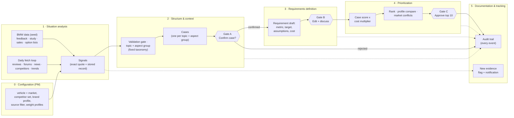

# End-to-End Flow: From Data to the PM's Decision

How the platform walks BMW's five-stage process ([process-cycle.md](../../01-challenge/process-cycle.md)) from raw data to an approved, traceable requirement. For each stage: what goes in, what the AI does on its own, where the PM decides, and what comes out.

Rewritten on 2026-10-11 to match the decided design (Signal → Case → Requirement, fixed taxonomy). The binding sources are [`CLAUDE.md`](../../../CLAUDE.md), [`architecture.mmd`](../../../architecture.mmd) and [`database-design.md`](../../../database-design.md); this page explains them along BMW's process. Scope and priorities: [scope-and-focus.md](scope-and-focus.md). Web fetching: [web-intelligence-loop.md](web-intelligence-loop.md). Screens: [ux-and-collaboration.md](ux-and-collaboration.md).


---

## 1. The flow at a glance

**Signal → Case (problem) → PM confirms → Requirement (solution) → PM approves → engineering.**



**Gates are diamonds.** Each gate is a mandatory human decision. Everything else the AI may do on its own, because it only creates proposals and flags and never changes the state of a case or a requirement. Every step writes to the audit trail.

---

## 2. Stage by stage

### Stage 0 · Configuration (PM-initiated)
| | |
|---|---|
| **PM inputs** | Vehicle + market (valid only if the line has sales there), competitor set (default list, AI suggests, PM confirms), brand profile (a versioned assumption the PM edits), source filter (e.g. skip social media), several weight profiles with a compare view |
| **AI does** | Checks that sales exist for the vehicle and market; suggests competitors |
| **Output** | `config` + `weight_profile` rows, first audit events |

Markets are separate worlds: China, the US and the Middle East have their own PMs. Each PM works a config (vehicle + market) on the **same shared data and the same logic**. There is no "exploration level" and no "project type" setting (both rejected): no case exists without signals, and the release-fit filter replaces the project type.

### Stage 1 · Situation analysis: evidence in, as signals
| | |
|---|---|
| **Inputs** | **Seed (once, logged):** BMW feedback (10,128 verbatims), customer study, sales volumes, option lists (equipment today). **Daily fetch loop:** competitor facts, public feedback, trends, innovations from the sources in [`fetching-sources.md`](../../05-web-sources/fetching-sources.md) |
| **AI does (autonomous)** | Stores every raw record first, then turns it into **signals**: one statement about one topic from one source record, with the exact quote, a short English summary, market, vehicle role, reach. Non-English quotes keep the original plus a translation |
| **Human does** | May exclude sources; may delete quarantined signals (content purged, tombstone kept) |
| **Output** | `source_record`, `data_record`, `signal` |

### Stage 2 · Structure & context: from signals to cases
| | |
|---|---|
| **AI does (autonomous)** | 1. **Validation gate:** schema, record stored, quote found in the record, duplicates, dated competitor facts. Failures go to a visible quarantine. 2. **Classification into the fixed taxonomy** ([`taxonomy/`](../../../taxonomy/README.md)): topic (219, BMW's VFC level 2) and aspect group (11). BMW rows by lookup from their labels; everything else by the LLM from closed lists. The car area (11) is derived from the topic. `other` goes to a review queue; no topic is ever created automatically. 3. **Cases:** signals are grouped by topic + aspect group ("Seats + comfort" and "Seats + reliability" are separate cases). Only large groups are split further by similarity, never across a topic. 4. **Figures per case:** distinct customers per market and powertrain, opinions, capped reach, study satisfaction, equipment today, competitor offer, trend. 5. **Tags proposed:** scope, brand fit, segment, release fit. 6. **Conflict flag** when one market is mostly negative and another mostly positive (≥ 5 distinct customers each); the AI shows the statistics and never decides |
| **Lifecycle (per vehicle)** | **observed** (overview map only) → **open** (enough distinct customers, a defect, a competitor gap or a removed feature; or opened by the PM) → **confirmed** or **rejected** |
| **Gate A: confirm the case** | **The PM** confirms or rejects (reason required), merges or splits cases, overrides tags. A case is the problem and has no cost |
| **Output** | `case_item`, `case_vehicle`, `case_score` |

### Stage 3 · Requirements definition
| | |
|---|---|
| **AI does (proposes)** | Only after the PM confirms a case: one requirement per case and BMW line (`REQ-G60-0012`), one per market when markets clearly differ (`REQ-G60-USA-0012`). Content: description, metric and target based on today's value and competitor values, acceptance criteria, release target (next generation, current car update, OTA), assumptions and uncertainties, evidence level, cost (option price if one exists, else an S / M / L estimate) |
| **Gate B: edit and discuss** | **PM and engineers** edit, re-target or delete (delete = tombstone). Every edit is logged with before/after and rationale; stale saves are rejected |
| **Output** | `requirement` in `draft` → `in_discussion` |

### Stage 4 · Prioritization
| | |
|---|---|
| **AI does (autonomous calculation)** | Case score per weight profile (§4). Requirement rank = case score x cost multiplier. Profile compare: which cases stay in the top N under every profile |
| **Gate C: approve** | **The PM** adjusts weights, overrides a rank by dragging (reason required), and approves; the approved top 10 go to engineering |
| **Output** | `case_score` snapshots with factor breakdown and rationale; requirement `approved` |

### Stage 5 · Documentation and tracking (continuous loop)
| | |
|---|---|
| **AI does (autonomous)** | Writes the append-only audit trail. The daily loop keeps attaching new signals. A confirmed case **never changes by itself**: it gets a flag ("+40 complaints since confirmation") and a notification |
| **Human does** | Decides whether the new evidence changes anything |
| **Output** | `audit_event`, `notification`, `decision` |

Not built yet: the export to codebeamer / Jira (later feature), and a monitor that judges new evidence against a requirement's target ("raises the bar", "contradicts"). Today the loop only flags that new evidence arrived.

---

## 3. Data objects: the traceability chain

Everything is linked by IDs, so any requirement can be walked back to the sentence a customer wrote. Tables and columns: [`database-design.md`](../../../database-design.md).

```
source_record (stored text, raw_ref) ──< signal >── feature (= topic) ── car_area
data_record (competitor / sales facts) ──┘   │           aspect_group
                                             └──> case_item (topic + aspect group)
                                                    ├──< case_vehicle (state, rank, release fit per line)
                                                    ├──< case_score (per weight profile, with breakdown)
                                                    └──< requirement (per line, per market if split)
audit_event (actor, timestamp, before/after, rationale) on every change
```

| Object | ID | Key content |
|---|---|---|
| Signal | uuid | quote (must be found in the stored record), summary ≤ 20 words, kind (complaint, wish, like, competitor fact, trend, innovation), severity, market, topic, aspect group, car area, vehicle role, evidence role, reach |
| Case | `CASE-0012` (no vehicle) | topic, aspect group, title and page (the problem), figures, tags; vehicles as tags |
| Requirement | `REQ-G60-0012` | description, metric, target, acceptance criteria, release target, assumptions, evidence level, cost, status |
| Score | per case and weight profile | factor values, weights, rationale text |
| Audit event | sequence | actor (`agent:…`, `pm:…`, `seed:…`), action, before, after, rationale |

Competitor signals (e.g. complaints about the E-Class) attach to the BMW case of the same topic as competitor evidence. They feed the competitor gap and never count as BMW customers.

---

## 4. Prioritization logic (explainable by design)

The score sits on the **case** (the problem) and has no cost in it. Default weights, all visible and tunable per weight profile:

| Factor | Default weight | How it is measured |
|---|---|---|
| Distinct customers | 0.25 | Distinct BMW customers in the case (log-scaled), not rows |
| Severity | 0.20 | Defect > difficult to use > wish; functional complaints weigh heavily |
| Satisfaction gap | 0.15 | Linked study attribute: low normalized mean, or high US dissatisfied share |
| Competitor gap | 0.15 | Rivals offer it and we do not, or only as an option |
| Market volume | 0.10 | 2030 sales of the config's market |
| Removed vs predecessor | 0.05 | The predecessor had it |
| Reach | 0.05 | Capped and log-scaled per market: one influencer is one opinion |
| Trend | 0.05 | Trend signals for the next 3 to 5 years |

**Brand fit** is a multiplier on the score (fits 1.0, neutral 0.8, off-brand 0.5), proposed by the AI with a reason and overridable by the PM. **Requirement rank** = case score x cost multiplier (S 1.0, M 0.85, L 0.7). The rationale text is generated from the factor breakdown.

**Kept separate from the score:**
- **Evidence level** (BMW data / web / assumption): how sure we are, not how important. Display only.
- **Market conflicts:** shown with statistics per market; the PM decides (one market, a market-specific requirement, or both).
- **Scope:** signals about pricing (aspect group `price`), regulation or homologation are tagged out of scope and stay visible.

---

## 5. Where AI acts and where humans decide

| Activity | AI autonomous | AI proposes, human confirms | Human only |
|---|---|---|---|
| Fetch, store, extract signals, validation gate | ✅ | | (PM can skip sources, delete quarantined signals) |
| Classify into topic and aspect group | ✅ (closed lists) | | Review queue for `other`; only a human changes the taxonomy |
| Group signals into cases, compute figures | ✅ | | (PM can merge and split) |
| Brand fit, segment, release fit | | ✅ | |
| Open a case by rule | ✅ | | |
| Confirm or reject a case (Gate A) | | | ✅ |
| Requirement text, metric, target, cost | | ✅ | |
| Score computation | ✅ (formula fixed and visible) | | |
| Weights, rank overrides, approval of the top 10 (Gate C) | | | ✅ |
| Page edits by the RAG sidebar | | ✅ (diff the PM accepts) | |
| New evidence on a confirmed case | ✅ (flag only) | | ✅ decides what follows |
| Market conflicts | ✅ (shows statistics) | | ✅ |
| Feasibility and cost decisions | | | Engineering, out of our scope |

---

## 6. Worked example: one case, end to end (G60, USA)

Evidence comes from the real data; scores, ranks and PM choices are illustrative.

| Stage | What happens |
|---|---|
| **0 Config** | G60 / USA, default competitor set, weight profile "balanced" |
| **1 Signals** | BMW verbatims such as G60-1430 ("wishes the vehicle still included the physical programmable memory buttons … 1-8 buttons made pulling up menus much quicker") and G60-1716 (radio presets as physical buttons). US study: *menu structure* top-2 36 %, bottom-3 13 %. Equipment today: Curved Display with BMW Controller, no physical favourite buttons in the option list |
| **2 Case** | The verbatims carry BMW's label *Operating concept, operating system* with a usability aspect, so they land in the case of that topic + aspect group. The same case collects F70 and G70 signals, because the operating concept is shared (Baukasten); each line's PM works it separately. The case opens by rule (enough distinct customers). **Gate A:** the G60 PM confirms |
| **3 Requirement** | Draft `REQ-G60-…`: "The driver reaches the most-used functions in at most 2 interactions, including programmable physical favourite buttons." Target and number of buttons are marked as assumptions; "removed vs predecessor" is true (the predecessor had buttons 1 to 8). **Gate B:** the PM sets 8 buttons and notes "align with the Baukasten" |
| **4 Rank** | High on distinct customers and satisfaction gap, removed vs predecessor, brand fit "fits" (driver focus), cost S or M. Stays in the top 10 under every weight profile. **Gate C:** approved |
| **5 Tracking** | Audit trail: case created by the case agent, opened by rule, confirmed by the PM, requirement generated, target edited with a reason, approved. Later the loop adds 40 signals; the case shows a new-evidence flag and does not change |

---

## 7. Mapping to the deliverables

| Deliverable | Covered by |
|---|---|
| 1. Concept and prototype | Stages 0 to 5 |
| 2. Requirement list (ID, description, signals and sources, score, rationale, evidence level, assumptions, status) | `requirement` + `case_score`, linked through the case to every signal and source |
| 3. End-to-end workflow with AI / human boundaries | §1, §2, §5 |
| 4. Audit trail | `audit_event` (append-only, enforced in the database) |
