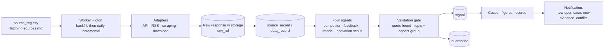

# Web Intelligence: the Daily Fetch Loop

How the platform keeps fetching external evidence (owner complaints and reviews, forums, expert reviews, competitor equipment, launches, market and trend data), turns it into traceable signals, and tells the PM when new evidence arrives.

Rewritten on 2026-10-11 to match the decided design and what is built. The binding sources are [`CLAUDE.md`](../../../CLAUDE.md) (pipeline step 2), [`fetching-sources.md`](../../05-web-sources/fetching-sources.md) (sources, fetch order, record format) and the code in `backend/app/fetch/`. The earlier version of this page (Exa search, SQLite, a `research/` folder, one workspace per PM) was a plan that was not followed.

---

## 1. Why it matters
- **The mission allows it:** "go deep on web research and turn external information into usable evidence".
- **It fills the biggest data gap:** the provided feedback has no Chinese verbatims, few European ones for the 5 and 7 Series, and nothing about the future. Competitors and 3-to-5-year trends come only from web research, labelled as external or assumption.
- **It removes the PMs' bottleneck:** research, and redoing it every time they are challenged.
- **BMW's process slide** marks competition, customer and public feedback, and product and global trends as inputs to the situation analysis, and documentation as a continuous loop.

## 2. Where it sits in BMW's process
| Stage | What the loop contributes |
|---|---|
| 1 Situation analysis | External **signals** in the same format as the BMW verbatims |
| 2 Structure & context | External and BMW signals land in the **same cases**: they share the fixed taxonomy (topic + aspect group) |
| 3 Requirements definition | Competitor facts (`data_record`) become benchmarks for metric targets |
| 4 Prioritization | Feeds the competitor gap, reach and trend factors |
| 5 Documentation and tracking | New signals on a confirmed case raise a flag and a notification. The loop **never edits** a case or a requirement |

## 3. Sources
The source list, URL patterns, categories and fetch order are in [`fetching-sources.md`](../../05-web-sources/fetching-sources.md) (owned by a teammate). Categories:

| Cat | Category | Question it answers |
|---|---|---|
| A | Owner complaints and defects | What does not work? |
| B | Owner reviews and ratings | What do owners like, dislike, miss? |
| C | Community discussion | What do people wish for, why do they switch brand? |
| D | Expert and video reviews | How does the car compare in a test? |
| E | Competitor equipment | What do rivals offer that we do not? |
| F | Market and sales trends | Which models, powertrains, segments are growing? |
| G | Quality and satisfaction studies | How do independent rankings place us? |
| H | Digital services and apps | What fails in the app and connected services? |
| I | Future trends | What will matter in 3 to 5 years? |
| J | New launches and model generations | What exists, what was just launched, what is coming? |

**Scope v1: fetch-order steps 1 to 9** (reference APIs, structured APIs, news and press feeds, app reviews, forums, owner review sites, expert reviews, price lists, market and trend data). Steps 10 to 13 (native Chinese sites, browser-only pages, login) come after v1; until then China evidence is the study plus English-language sources, and the coverage gap is stated openly.

A general search provider is only needed for discovery (e.g. new launches) and stays pluggable; the sources file gives URL patterns and APIs directly.

## 4. How fetching works
- **Worker:** `python -m app.fetch.worker [--backfill] [--steps 1-9] [--dry-run]`, run daily by cron. One `agent_run` row per run.
- **Depth:** one backfill over all pages, then daily incremental runs that stop at already-stored records (`last_cursor` per source).
- **Budget:** a daily request budget with priority: topics with open cases first, the rest rotates.
- **Polite fetching:** robots.txt respected, per-site delay, identifying user agent, retries. No paid anti-bot circumvention, no login walls.
- **Raw first:** the raw response is stored before anything is extracted (`raw_ref`), so the evidence survives page edits or deletion.
- **Vehicles and search terms** come from the `competitor` and `search_term` tables; vehicle and market are configuration, never hard-coded.

**Four agents** read stored records and propose signals:

| Agent | Categories | Produces |
|---|---|---|
| Competitor | J, E | launches, competitor equipment facts |
| Customer / public feedback | A, B, C, D, H | complaints, wishes, likes |
| Trends | F, G, I | market and customer trends |
| Innovation scout | I, J from shows and other industries | innovations |

## 5. From record to signal
Agents only **propose** signals; the validation gate decides, and agents can never write a case.

1. **Extraction (LLM, strict output schema):** kind, severity, exact quote in the original language, English translation, summary of at most 20 words, market, and **topic + aspect group picked from the closed lists** of the fixed taxonomy ([`taxonomy/`](../../../taxonomy/README.md)). The model cannot return an invented topic; `other` is the only way out and goes to a review queue. The car area is derived from the topic in code.
2. **Validation gate:** the record is stored; the quote is found in the stored text; kind and severity fit; topic and aspect group exist; no duplicate (same record, or the same author posting the same text elsewhere); competitor facts are dated. A failed check sends the signal to a visible quarantine with the reason.
3. **Tagging in code:** records published before the line went on sale are tagged `predecessor` and kept; pricing, regulation and homologation statements are tagged out of scope and kept.
4. **Cases:** the signal joins the case of its topic + aspect group. Competitor signals attach as competitor evidence and never count as BMW customers.

**Prompt injection:** page text is data, never instructions. It is wrapped as untrusted source text in every prompt.

## 6. Market (never silently assumed)
Markets are `USA`, `China`, `Europe`, `Rest of World`, `unknown`. Every signal stores how the market is known (`market_basis`):

| Basis | Example |
|---|---|
| `stated` | The text or the record names the country ("here in Norway …"); a BMW verbatim with a country |
| `inferred` | From the source's country (a German forum, a US review site) |
| `unknown` | Nothing reliable (an international subreddit) |

## 7. Traceability: "see exactly what we saw"
- **Exact quote:** a signal is only valid if its quote is found in the stored record. No source means no signal.
- **Stored record:** the text as retrieved, with a content hash and the raw response in storage.
- **Provenance:** run, agent, model and prompt version are stored with every signal; the audit trail shows the agent as actor.
- **Source filter:** the PM can skip sources (e.g. social media users who are not the target audience); the filter applies when figures and boards are read, so one signal can serve several configs.

## 8. Reach is not relevance
- Cases count **distinct customers** (BMW verbatim ID, or `author_hash` for web authors), not rows, views or likes.
- Reach is stored, **capped per signal** and log-scaled, with a default weight of 0.05: one influencer is one opinion.
- Evidence level (BMW data / web / assumption) is shown next to every requirement and is not part of the score. Background on source trust: [external-sources.md](../../02-bmw-data/external-sources.md).

## 9. Monitoring
What exists: new signals keep attaching to cases after confirmation. A confirmed case never changes by itself; it gets a new-evidence flag and a notification ("+40 complaints since confirmation"), and the PM decides.

Not built: a monitor that compares new evidence with a requirement's target and gives a verdict ("supports", "contradicts", "raises the bar", e.g. a rival's new range figure beats our target). It is a concept for later.

## 10. Status (2026-10-11)
| Part | State |
|---|---|
| Polite client, worker, dry-run plan, four agents | Built, 7 tests on recorded responses |
| Adapters | wikipedia, wikidata, nhtsa-vpic, fueleconomy, nhtsa-complaints, nhtsa-recalls, reddit (needs OAuth), youtube-comments (needs a key; transcripts skipped), RSS feeds, app store, XenForo forums, magazines, kbb, downloads |
| Adapters missing | motor-talk, pistonheads, carcomplaints, autoscout24, ams, autobild, adac-autotest, automobile-magazine, teknikens-varld, google-play, google-trends, press pages without feeds |
| First real backfill | Not run: needs the OpenAI key, Reddit OAuth and a YouTube Data API key |
| On-demand predecessor research | Not built |

## 11. Legal, ethics and honesty
- Prefer official APIs and feeds over scraping; respect robots.txt and terms of use.
- Authors are stored as a hash (`author_hash`), only to count distinct customers.
- In BMW production this would plug into BMW's existing social-listening and sentiment vendors; our loop shows the logic and the traceability.
- **Limitations to state openly:** Chinese platform coverage, missing transcripts, LLM extraction errors (mitigated by the quote check), and the US skew of English-language forums.
